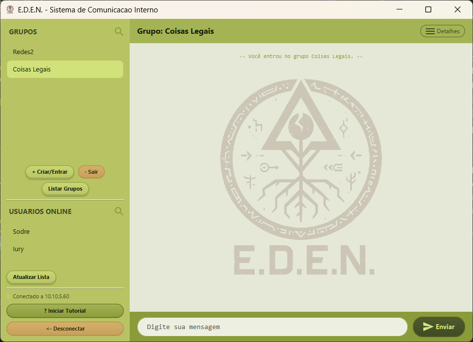

# E.D.E.N - Sistema de Comunicação Distribuído com Redundância e Alta Disponibilidade



## Visão Geral

O projeto **E.D.E.N** é uma aplicação de chat distribuído desenvolvida em Java (JDK 8 / JavaFX) para comunicação interna em rede local e tolerância a falhas. O sistema integra uma arquitetura híbrida de mensageria (TCP para controle, UDP para conteúdo instantâneo e UDP Broadcast para descoberta automática) com **redundância ativa-passiva ($N$ Servidores)**, garantindo que o serviço permaneça ininterrupto para os clientes mesmo diante da queda arbitrária de múltiplos nós do servidor.

### Informações do Projeto
- **Autor:** Iury Ramos Sodré
- **Matrícula:** 202310440
- **Disciplina:** Sistemas Distribuídos
- **Semestre:** 8º
- **Trabalho 02:** Redundância e Replicação Integral de Servidores com Failover Transparente

---

## Requisitos do Trabalho 02 (Redundância no Servidor)

1. **$N$ Servidores com Liderança Única:** O cluster opera com $N$ servidores ($N \ge 1$), contudo exatamente **UM servidor atua como `ATIVO`** por vez atendendo aos clientes, enquanto os outros $N-1$ permanecem em **`STANDBY`**.
2. **Replicação Integral de Estruturas de Dados:** O estado de controle (`GerenciadorGrupos`: usuários cadastrados, membros de salas, permissões, bloqueios, mensagens e status de entrega) é replicado de forma integral e determinística entre todos os servidores.
3. **Failover Automático e Silencioso:** Caso o servidor ativo sofra qualquer falha (queda de processo, quebra de rede, encerramento forçado `kill -9`), um dos servidores em standby assume automaticamente a liderança e retoma os serviços sem perda de dados ou fechamento das interfaces dos clientes.
4. **Resiliência em Cadeia:** Caso o segundo servidor também caia, o terceiro assume, e assim sucessivamente até o último sobrevivente.
5. **Recuperação sem Preempção (Regra D1):** Caso um nó retorne após uma queda, ele sincroniza seu estado via snapshot a partir do líder ativo e entra em modo `STANDBY`, **sem derrubar ou preempcionar o líder atual**. Ele apenas assumirá caso o líder ativo venha a falhar.
6. **Replicação Síncrona Rigorosa (Regra D2):** Cada operação de escrita executada pelo líder ativo só é respondida ao cliente após ser replicada e confirmada (ACK) por **todos os nós em standby vivos**.
7. **Versatilidade de Ambientes (Regra D3):** O sistema suporta execução tanto em **máquinas distintas na rede local** (via `cluster.properties`) quanto na **mesma máquina** (via flag `--local <id> <N>`), facilitando tanto testes de bancada quanto apresentação no laboratório.
8. **Interface do Servidor via Console (Regra D5):** Logs detalhados e comandos interativos de depuração no terminal (`status`, `estado`, `ajuda`, `sair`), sem necessidade de interface gráfica pesada no servidor.

---

## Arquitetura de Redundância e Consenso

```
                        +----------------------------+
                        |  CLIENTES (JavaFX / GUI)  |
                        |   GerenciadorConexao      |
                        +--------------+-------------+
                                       |
                   Failover            |  Comandos TCP / PING
                  Transparente         |  Mensagens UDP
                                       v
                             +------------------+
                             |  Nó 1 (ATIVO)    |
                             |  Portas Abertas  |
                             +----+--------+----+
                                  |        |
         Replicação Síncrona (TCP)|        | Heartbeats Periódicos (1s)
         + ACKs de Confirmação    |        |
                                  v        v
                   +------------------+  +------------------+
                   | Nó 2 (STANDBY)   |  | Nó 3 (STANDBY)   |
                   | Portas Fechadas  |  | Portas Fechadas  |
                   +--------+---------+  +---------+--------+
                            \                      /
                             \-- Malha TCP Mesh --/
                                 Eleição Raft/Bully
```

### Componentes do Cluster (`Servidor/cluster/`):
- **`NoCluster`**: Máquina de estados finitos (`ATIVO`, `STANDBY`, `SINCRONIZANDO`, `CANDIDATO`), transmissor de heartbeats periódicos (1000ms), detector de falhas e orquestrador de eleição.
- **`GerenciadorGrupos`**: Fonte única da verdade em memória. Modificações geram um log sequencial de versões monotônicas (`versao`), permitindo exportação e importação de snapshots serializados íntegros.
- **`Replicador`**: Gerenciador de replicação síncrona com barreira de confirmação (`CountDownLatch`). Bloqueia a confirmação ao cliente até obter o quorum de todos os standbys vivos. Mantém log circular de operações.
- **`CanalCluster`**: Malha de conexões TCP bidirecionais persistentes com reconexão contínua em segundo plano e detecção imediata de socket quebrado (`EOFException`).
- **`VisaoCluster`**: Tabela em memória registrando a saúde, latência, versão e papel de cada nó do cluster.
- **`ConfigCluster`**: Gerenciador de portas e topologia, com suporte automático tanto a instâncias locais com portas offsetadas quanto a IPs distribuídos na rede.
- **`NotificadorClientes`**: Despacha rajadas de avisos `SERVER_CHANGED` aos clientes cadastrados via UDP para acelerar a comutação de destino quando um novo líder é eleito.

---

## Mecanismos de Tolerância a Falhas

### 1. Detecção de Falhas
- **Heartbeat e Timeout:** Nós trocam batimentos cardíacos a cada **1.000 ms**. Caso o líder ativo não envie heartbeats por mais de **3.000 ms**, ele é declarado `DOWN`.
- **Detecção Imediata por Conexão:** Quedas forçadas (`kill -9`, interrupção de processo) disparam `EOFException` no socket TCP do `CanalCluster`, engatilhando a eleição em milissegundos.

### 2. Algoritmo de Eleição
- Quando a falha do líder é confirmada, os nós elegíveis avaliam seu estado.
- O critério de desempate prioriza: **1º Maior Versão de Dados (`versao`)**; **2º Menor ID de Nó (`meuId`)**.
- Um escalonamento temporal determinístico baseado no ID (`delay = (id - 1) * 80 ms`) impede tempestades de propostas simultâneas (*split-brain*).
- O candidato envia uma `PROPOSTA` para a nova época (`epoca + 1`). Ao receber a aprovação da maioria/totalidade dos nós vivos, assume o papel `ATIVO`, abre as portas de atendimento e transmite o anúncio `COORDENADOR`.

### 3. Recuperação e Sincronização (Regra D1)
- Um nó que estava fora do ar e retorna conecta-se à malha de nós.
- Ao detectar que já existe um nó operando como `ATIVO`, ele solicita um snapshot (`PEDIDO_SYNC`).
- O nó ativo envia a imagem completa de dados (`SNAPSHOT`). O nó recém-chegado instala o estado em seu `GerenciadorGrupos` e transita diretamente para **`STANDBY`**, preservando a estabilidade do líder vigente.

### 4. Failover no Cliente (Regra D4)
- A camada cliente possui o `GerenciadorConexao`, que dispara requisições de `PING` TCP a cada **2.000 ms**.
- Se duas sondagens falharem consecutivamente ou a conexão for perdida, o cliente entra em modo silencioso de failover:
  - Dispara o callback `onConexaoPerdida()`, exibindo aviso visual amarelo na interface sem travar ou fechar a janela.
  - Percorre a lista de servidores conhecidos ou escuta a notificação UDP `SERVER_CHANGED`.
  - Ao localizar o novo líder ativo, comuta os sockets TCP e UDP, refaz o registro transparente e dispara `onReconectado()`.
  - O histórico de conversas, grupos e mensagens da tela do usuário permanece 100% preservado.

---

## Como Executar o Sistema

### Pré-requisitos
- **Java JDK 8** (recomendado Zulu OpenJDK 8 com JavaFX integrado)
- Linux / Windows / macOS

### Compilação dos Módulos

Compile os módulos a partir da raiz do projeto:

```bash
# Compilar o Servidor e pacote de Cluster
javac -d Servidor/bin Servidor/Protocol/*.java Servidor/utils/*.java Servidor/controller/*.java Servidor/model/*.java Servidor/cluster/*.java Servidor/*.java

# Compilar o Cliente e Interface JavaFX
javac -d Cliente/bin Cliente/Protocol/*.java Cliente/utils/*.java Cliente/exceptions/*.java Cliente/model/*.java Cliente/view/*.java Cliente/*.java
```

---

### Cenário 1: Teste em Máquina Única (Modo Local - Auto-ID e Cluster Dinâmico)

Permite testar $N$ instâncias do servidor simultaneamente no mesmo computador. **Não é necessário digitar ID nem tamanho do cluster**: o sistema detecta as portas em uso e atribui automaticamente o próximo ID livre, integrando novos nós em tempo real!

- **Nó 1 (ID 1 automático):** Porta Cluster `9001` | TCP Atendimento `6789` | UDP Atendimento `7777` | Discovery `8888`
- **Nó 2 (ID 2 automático):** Porta Cluster `9002` | TCP Atendimento `6799` | UDP Atendimento `7787`
- **Nó 3 (ID 3 automático):** Porta Cluster `9003` | TCP Atendimento `6809` | UDP Atendimento `7797`
- **Nó N (ID N automático):** Cluster `9000 + N` | TCP `6789 + 10(N-1)` | UDP `7777 + 10(N-1)`

Abra quantos terminais desejar (o cluster pode crescer indefinidamente):

```bash
# Terminal 1:
java -cp Servidor/bin Principal --local

# Terminal 2:
java -cp Servidor/bin Principal --local

# Terminal 3:
java -cp Servidor/bin Principal --local

# Terminal N (qualquer nó adicional junta-se dinamicamente):
java -cp Servidor/bin Principal --local
```

O primeiro nó assumirá como `ATIVO` e os demais entrarão automaticamente como `STANDBY`.

Em outro terminal, execute o Cliente GUI:
```bash
java -cp Cliente/bin Principal
```
*(No login do cliente, clique em **Buscar** para conectar-se diretamente ao cluster ativo sem necessidade de escolher em listas).*

---

### Cenário 2: Teste Distribuído em Máquinas Distintas na Rede Local (LAN)

Para executar cada servidor em computadores diferentes (ex: laboratório da faculdade):

Em cada máquina, execute simplesmente:
```bash
java -cp Servidor/bin Principal --rede
```
*(Ou execute sem parâmetros e digite `2` no menu interativo).*

O sistema utiliza o **Beacon UDP (porta 9876)** em broadcast para auto-descoberta:
- A primeira máquina iniciada assume **ID 1** como pioneira do cluster.
- Cada nova máquina iniciada na mesma rede descobre os nós existentes via broadcast, assume o próximo ID livre automaticamente e junta-se ao cluster sem qualquer intervenção manual!
- Caso prefira IPs pré-fixados, o uso de `cluster.properties` continua suportado como alternativa: `java -cp Servidor/bin Principal <ID> cluster.properties`.

---

## Comandos Interativos de Console no Servidor (Regra D5)

No terminal de qualquer nó do servidor em execução, digite:

| Comando | Descrição |
| :--- | :--- |
| `status` | Exibe o papel local (`ATIVO` / `STANDBY`), a época atual, o líder ativo e a saúde/versão de todos os pares do cluster. |
| `estado` | Imprime o dump completo do `GerenciadorGrupos` (versão da réplica, hash criptográfico, usuários cadastrados e grupos). |
| `ajuda` | Lista todos os comandos disponíveis no console. |
| `sair` | Encerra o nó graciosamente emitindo uma mensagem de renúncia (`RENUNCIA`), disparando eleição imediata nos outros nós. |

---

## Execução dos Testes Automatizados de Validação

Dois testes automatizados cobrem a verificação rigorosa de todo o ciclo de vida do cluster:

### 1. Teste de Cluster Completo, Replicação e Não-Preempção
Executa os 7 passos da especificação: inicialização de 3 nós, replicação síncrona de usuários e grupos, derrubada forçada com `kill -9` do líder, validação da eleição automática, checagem da integridade dos dados replicados no novo líder e retorno do nó caído sem preempção.

```bash
# Compilar e executar o teste completo de cluster:
javac -cp "Servidor/bin:Cliente/bin" -d /tmp scratch/TestadorClusterCompleto.java
java -cp "/tmp:Servidor/bin:Cliente/bin" scratch.TestadorClusterCompleto
```

### 2. Teste de Failover Transparente do Cliente
Valida o comportamento da camada cliente com detecção automática de falha de conexão, disparo dos callbacks `onConexaoPerdida()` e `onReconectado()`, e continuidade operacional de envio e recebimento de comandos contra o novo líder.

```bash
# Compilar e executar o teste de failover do cliente:
javac -cp "Servidor/bin:Cliente/bin" -d /tmp scratch/TesteFailoverCliente.java
java -cp "/tmp:Servidor/bin:Cliente/bin" scratch.TesteFailoverCliente
```

### 3. Teste de Auto-ID e Cluster Dinâmico Infinito
Valida o escalonamento automático de nós sem IDs fixos (4 nós iniciados sem parâmetros manuais que alocam portas e IDs de 1 a 4 dinamicamente) e suporta expansão em tempo real.

```bash
# Compilar e executar o teste de auto-ID e dinamismo:
javac -cp "Servidor/bin:Cliente/bin" -d /tmp scratch/TesteAutoIdEDinamico.java
java -cp "/tmp:Servidor/bin:Cliente/bin" scratch.TesteAutoIdEDinamico
```

---

## Estrutura do Repositório

```text
├── Cliente/                     # Aplicação do Cliente
│   ├── exceptions/              # Exceções personalizadas
│   ├── model/                   # ClienteTCP, ClienteUDP, GerenciadorConexao, MessageListener
│   ├── Protocol/                # Estrutura APDU compartilhada
│   ├── utils/                   # Constantes de Protocolo e InfoUser
│   ├── view/                    # Interface gráfica em JavaFX (ClienteGUI, TutorialOverlay)
│   └── Principal.java           # Ponto de entrada do Cliente GUI
│
├── Servidor/                    # Aplicação do Servidor
│   ├── cluster/                 # Mecanismo de Redundância e Consenso
│   │   ├── CanalCluster.java    # Malha TCP ponto-a-ponto entre servidores
│   │   ├── ConfigCluster.java   # Topologia e offsets de portas
│   │   ├── MensagemCluster.java # Mensagens do protocolo interno do cluster
│   │   ├── NoCluster.java       # Máquina de estados, heartbeats e eleição
│   │   ├── Replicador.java      # Replicação síncrona com quorum de ACKs e snapshot
│   │   └── VisaoCluster.java    # Tabela de saúde e estados dos pares
│   ├── controller/              # GerenciadorGrupos (fonte única da verdade)
│   ├── model/                   # ServidorTCP, ServidorUDP, ServidorDiscovery, Notificador
│   ├── Protocol/                # Estrutura APDU do servidor
│   ├── utils/                   # Constantes de Protocolo e InfoUser
│   └── Principal.java           # Ponto de entrada do Servidor (CLI e Console)
│
├── cluster.properties.exemplo   # Modelo de configuração para múltiplas máquinas
└── README.md                    # Documentação técnica completa
```

---

## Licença e Uso Acadêmico

Projeto desenvolvido por **Iury Ramos Sodré** para a disciplina de **Sistemas Distribuídos** da UESB (Universidade Estadual do Sudoeste da Bahia). Caráter estritamente educacional e acadêmico.
